# Qwen3.8-27B on one RTX 3090: final benchmark (2026-10-14)

## Summary

Our megakernel build (branch `qwen38-perf` of cutlerbenjamin1-cmd/open-jet, commit fabce52 + docs) against llama.cpp and
the public megakernel, all on the same RTX 3090 (24 GB). Charts are inline below (PNG files in `charts/`), raw data in `data/`.

- **vs llama.cpp** (UD-Q4_K_XL, 120k context, both with an 8-bit KV cache): decode 1.75x faster on short chats, 1.97x on
  sampled thinking, 1.91x at 101.6k tokens of context. Prefill is 1.28x faster. Re-answering after you edit an earlier
  message takes 0.08 s instead of 0.33 s. It uses 1.7 GB less VRAM. The 282 benchmark questions finish in 1,778 s instead
  of 2,727 s (1.53x) with the same accuracy: 230 vs 229 correct.
- **vs the public megakernel** (plain Q4_K_M, the Reddit author's own benchmark scripts): writing code 173 vs 134 tok/s
  (+29%), 30K tokens of code in context 118 vs 87 (+34%), reasoning mode 125 vs 89 (+41%), prefill 1,811 vs 1,527 tok/s
  (+19%). His post reported 140 tok/s writing code on his card.
- **262,144 tokens of context** (the model's maximum) on 24 GB with the low-bit KV preset D'. Prefilling 261k tokens from
  scratch takes 337 s. Decode at that depth runs at 62 tok/s, and a follow-up turn starts in 2.2 s. Needle retrieval was
  8 of 8 at 190k and 261k, on both model files.
- **Preset D'** (6-bit K, 5-bit V, recent 2,048 tokens in 8-bit) gave the same answer as the 8-bit cache on all 282
  questions, for both model files, with 1.0 GB less VRAM.
- **UD-Q4_K_XL vs plain Q4_K_M**: no measurable quality difference. They score 230 vs 231 of 282, disagree on 15 answers
  (7 vs 8) and have the same perplexity. Plain Q4_K_M is 2-16% faster and uses 0.4 GB less VRAM. On this evidence, UD does
  not pay for itself on this engine (details in section 6).

Setup: Qwen3.8-27B, unsloth's UD-Q4_K_XL (17.56 GB) and plain Q4_K_M (17.11 GB). Greedy decoding unless stated, 7 MTP
drafts, exact prompt reuse on. One RTX 3090 (Ampere, 24 GB, 480 W limit, fan 96%), Windows 11 + WSL2, CUDA 13.2. Every
number in the "ours" columns is from one session (2026-10-14 17:57-22:02).

## 1. Speed at 120k context

Same client, prompts and settings as the earlier head-to-heads (h2h2 / sweep3). One server at a time, and a 3 s warm-up
request first (section 8). The llama.cpp column is the best value of each metric over three earlier sessions of the
user's tuned llama.cpp b11548 (q8_0 KV, 4 MTP drafts).

| metric | llama.cpp | ours, UD q8 | ours, UD D' | ours, plain q8 | ours, plain D' |
|---|---|---|---|---|---|
| greedy decode, short prompts (mean of 4), tok/s | 82.7 | 144.7 | 145.0 | 148.1 | 147.7 |
| sampled thinking decode (mean of 8), tok/s | 65.8 | 129.8 | 128.9 | 136.2 | 138.7 |
| decode at 11.6k depth, tok/s | 69.3 | 128.6 | 125.9 | 145.7 | 142.2 |
| decode at 38k depth, tok/s | 62.3 | 109.9 | 97.4 | 109.4 | 108.7 |
| decode at 101.6k depth, tok/s | 53.4 | 102.0 | 94.0 | 106.0 | 99.8 |
| time to first token, short prompt, ms | 124 | 71 | 69 | 70 | 70 |
| follow-up turn, prompt time (11.8k chat), ms | 323 | 183 | 191 | 181 | 186 |
| prefill 11.6k tokens, s | 8.24 | 6.24 | 6.45 | 6.13 | 6.24 |
| prefill 38k tokens, s | 29.6 | 23.0 | 24.0 | 22.7 | 23.3 |
| prefill 101.6k tokens, from scratch, s | 101.0 | 79.0 | 83.1 | 77.6 | 81.2 |
| edit an earlier message (11.7k chat), s | 0.33 | 0.081 | 0.079 | 0.074 | 0.077 |
| edit the end of a 9.1k system prompt, s | 0.96 | 0.092 | 0.101 | 0.086 | 0.095 |
| VRAM, whole card (server idle = after 101.6k), GB | 22.8 | 21.1 | 20.1 | 20.7 | 19.7 |

The long-context decode rows (38k, 101.6k) are each one 256-token reply. D' changes the numerics, so the reply text, and
with it the draft acceptance, can differ from the q8 run. Controlled A-B-A runs on the same text put D' at about 7% below
q8 at 101.6k. The follow-up turn re-processes the previous reply because exact reuse is on: 183 ms, against about 80 ms
without exact reuse.

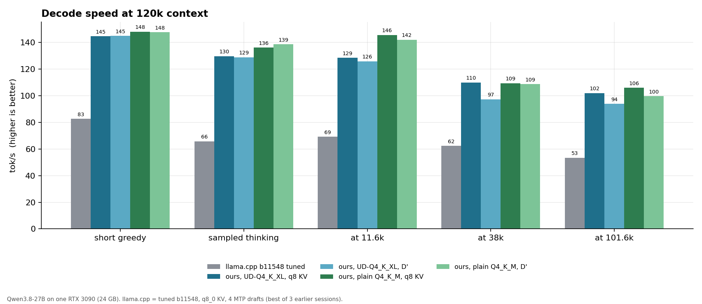
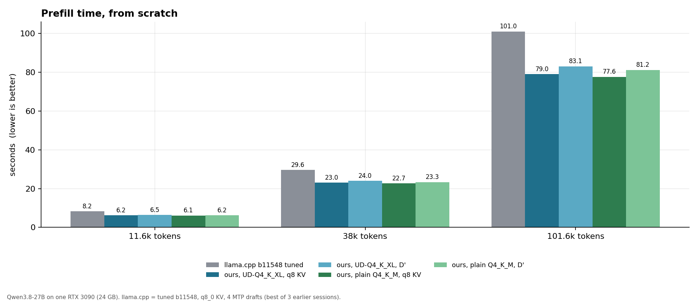
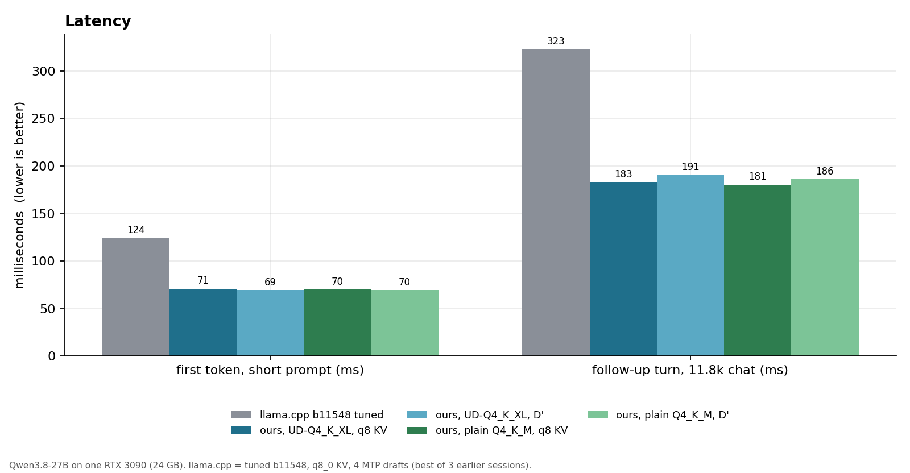
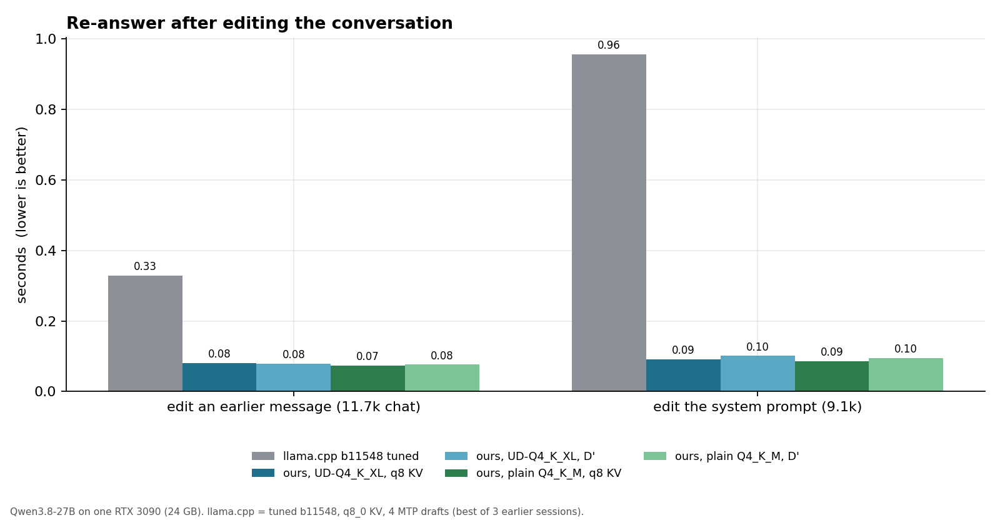
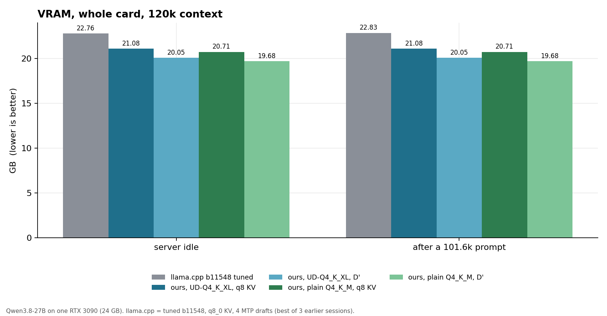

## 2. The Reddit author's benchmarks (his scripts, unchanged)

`bench/code_bench.py` and `bench/think_bench.py` (megakernel halves): best of 2, greedy code runs, his xhigh thinking
preset with seeds 1000 / 1001, and the same prompt files as our 10-13 run. The public megakernel is upstream open-jet
2993f47 at `-d 4` (his setting), measured on this card on 10-13. It supports plain Q4_K_M only; its README routes UD
quants to llama.cpp. Ours runs at `-d 7 --kv q8`.

| test (tok/s) | his post (his card) | public megakernel | ours, plain q8 | ours, plain D' | ours, UD q8 | ours, UD D' |
|---|---|---|---|---|---|---|
| writing code (ctx 0) | 140 | 133.8 | **173.3** | 172.7 | 148.8 | 148.7 |
| 30K tokens of code in context | 73 | 87.4 | **117.5** | 123.3 | 107.9 | 115.4 |
| short prompts (mean of 4) | - | 118.0 | **149.2** | 148.8 | 146.0 | 145.2 |
| reasoning mode (4 prompts x 2 seeds, 1,024 tok) | 78 | 89.1 | **125.4** | 125.3 | 112.7 | 111.1 |
| prefill, 29.6K-token prompt | ~1,600 | 1,527 | **1,811** | 1,793 | 1,783 | 1,763 |

Plain Q4_K_M, ours vs the public engine: +29% / +34% / +26% / +41% / +19%. Reasoning mode samples at temperature 1.0, so
read its row as indicative. A short CLI run would start at the idle clocks described in section 8, so a small helper kept
the GPU busy during each model load and stopped before any timed work.

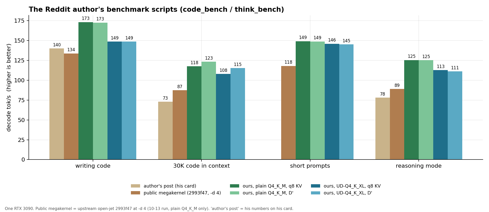
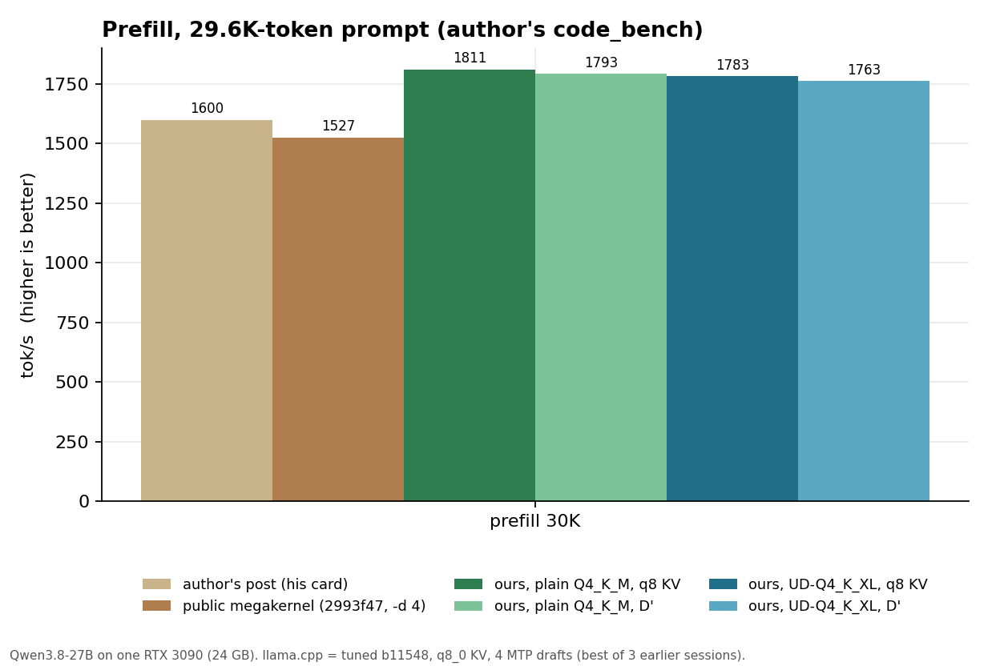

## 3. Quality: 282 benchmark questions

Seeded samples of public test sets. Same zero-shot prompts, greedy decoding, same scorer for every engine (HumanEval
completions are executed). The llama.cpp run is from 10-13 (same harness).

| set | n | llama.cpp | ours, UD q8 | ours, UD D' | ours, plain q8 | ours, plain D' |
|---|---|---|---|---|---|---|
| GSM8K | 50 | 50 | 50 | 50 | 48 | 48 |
| MMLU-Pro (5 per subject) | 70 | 45 | 47 | 47 | 51 | 51 |
| ARC-Challenge | 50 | 47 | 47 | 47 | 47 | 47 |
| MATH-500 (8 per level) | 40 | 29 | 29 | 29 | 27 | 27 |
| MATH-500 level 5, thinking | 10 | 9 | 9 | 9 | 9 | 9 |
| HumanEval (every 4th) | 41 | 38 | 37 | 37 | 38 | 38 |
| Needle in a haystack, 32k / 64k / 100k | 9 | 9 | 9 | 9 | 9 | 9 |
| LongBench v2, 20k-99k tokens | 12 | 2 | 2 | 2 | 2 | 2 |
| **total** | **282** | **229** | **230** | **230** | **231** | **231** |

With 40-70 items per set, differences under about 5 points are noise. LongBench v2 uses its official no-CoT prompt with
max_tokens 128, and 8 of 12 answers were cut off in every engine, so its absolute score says little. D' vs q8: identical
correctness on all 282 items for both model files.

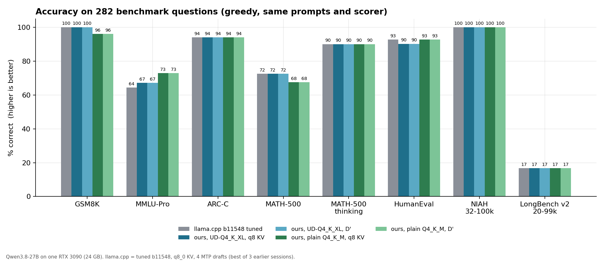

## 4. Time and speed per question set

Sums over each set (wall s = time to the finished answers; prefill and decode tok/s = tokens / server time):

| set | llama.cpp: wall s / prefill / decode | ours, UD q8 | ours, UD D' | ours, plain q8 | ours, plain D' |
|---|---|---|---|---|---|
| GSM8K | 167 / 534 / 100 | 92 / 876 / 179 | 92 / 864 / 179 | 90 / 889 / 184 | 90 / 899 / 184 |
| MMLU-Pro | 675 / 906 / 84 | 419 / 1,294 / 134 | 415 / 1,304 / 136 | 394 / 1,347 / 141 | 395 / 1,336 / 141 |
| ARC-Challenge | 14 / 544 / 41 | 7 / 808 / 70 | 7 / 798 / 70 | 7 / 841 / 75 | 7 / 829 / 74 |
| MATH-500 | 365 / 637 / 97 | 202 / 950 / 173 | 200 / 953 / 175 | 197 / 992 / 182 | 198 / 983 / 181 |
| MATH-500 thinking | 208 / 642 / 82 | 94 / 1,208 / 147 | 97 / 1,155 / 146 | 88 / 1,257 / 150 | 88 / 1,190 / 150 |
| HumanEval | 117 / 850 / 104 | 58 / 1,184 / 211 | 57 / 1,190 / 212 | 54 / 1,231 / 226 | 54 / 1,220 / 225 |
| NIAH 32k-100k | 543 / 1,097 / 62 | 415 / 1,419 / 211 | 428 / 1,374 / 208 | 406 / 1,449 / 241 | 420 / 1,400 / 237 |
| LongBench v2 | 639 / 1,135 / 69 | 491 / 1,444 / 137 | 509 / 1,395 / 128 | 482 / 1,469 / 150 | 499 / 1,421 / 136 |
| **all 282, wall s** | **2,727** | **1,778 (1.53x)** | **1,806 (1.51x)** | **1,719 (1.59x)** | **1,752 (1.56x)** |

Answers cut by the token cap: llama.cpp 45, every megakernel run 42 (mostly MMLU-Pro 22-25, MATH-500 8, LongBench 8).

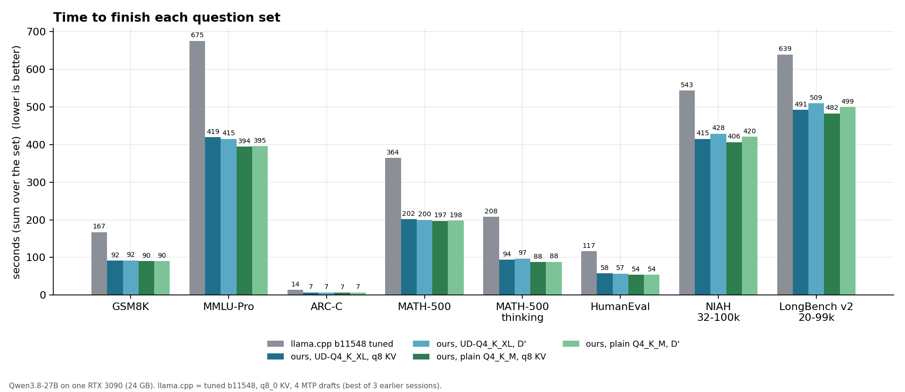
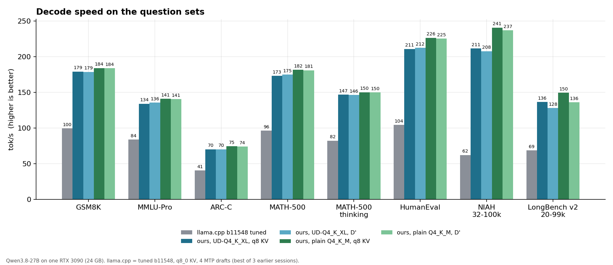
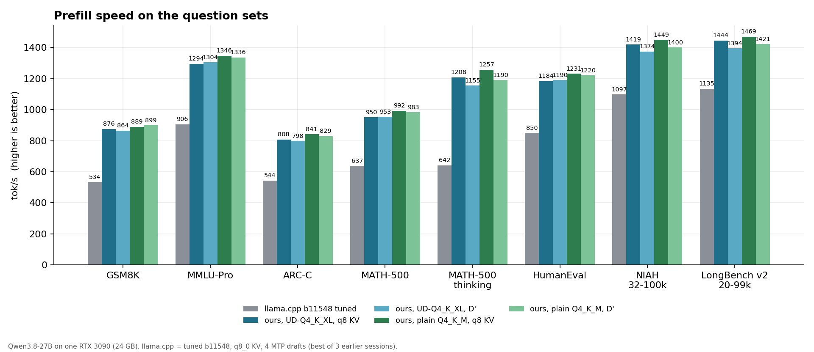

## 5. Maximum context with preset D' (262,144 tokens)

Server at `-c 262144` with `MK_KV='K*=6,V*=5,*16=8' MK_KV_WIN=2048`. Every long prompt was prefilled from scratch.

| | UD-Q4_K_XL | plain Q4_K_M |
|---|---|---|
| prefill 260,896 tokens from scratch | 337.0 s (774 tok/s) | 333.3 s (783 tok/s) |
| decode at 261k depth (512-token summary) | 62.1 tok/s | 61.8 tok/s |
| follow-up turn (260,864 tokens reused) | 2.2 s to start, 66.8 tok/s | 2.2 s, 63.0 tok/s |
| VRAM, whole card | 23.62 GB | 23.25 GB |
| needle in a haystack, 190k (2) + 261k (2) | 4 / 4 | 4 / 4 |
| LongBench v2, 137k-235k tokens (6, max_tokens 1024) | 4 / 6 | 3 / 6 |

LongBench v2 items (prompt tokens, UD prefill s, correct UD / plain): Multi-Document QA, hard, 137k, 125 s, no / no;
Long Structured Data, easy, 144k, 133 s, yes / yes; Long In-context Learning, easy, 186k, 198 s, yes / yes;
Single-Document QA, hard, 186k, 196 s, no / no; Code Repository QA, easy, 235k, 285 s, yes / no; Single-Document QA,
hard, 219k, 254 s, yes / yes.

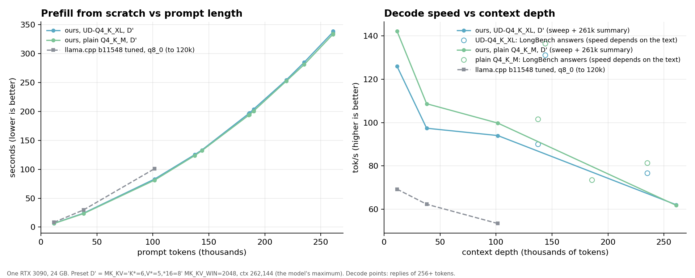

## 6. Does UD-Q4_K_XL pay over plain Q4_K_M?

| | UD-Q4_K_XL | plain Q4_K_M |
|---|---|---|
| file size | 17.56 GB | 17.11 GB |
| VRAM at 120k, q8 KV | 21.08 GB | 20.71 GB |
| perplexity, llama.cpp reference files (13,299 tokens, same text) | 2.810 | 2.815 |
| benchmark questions, q8 KV (282) | 230 | 231 |
| answers where only this model is right (paired, 282) | 7 | 8 |
| needle at 190k / 261k, D' | 4 / 4 | 4 / 4 |
| LongBench v2 137k-235k, D' | 4 / 6 | 3 / 6 |
| writing code / reasoning (author's scripts), tok/s | 148.8 / 112.7 | 173.3 / 125.4 |
| greedy / sampled thinking (section 1), tok/s | 144.7 / 129.8 | 148.1 / 136.2 |

- Where they differ: UD is ahead on GSM8K (+2) and MATH-500 (+2), plain on MMLU-Pro (+4 net: 2 vs 6) and HumanEval (+1
  net). The 7 / 8 split is a coin flip. The perplexity gap is about 1 standard error (UD better on 9 of 13 text segments).
- Unsloth's own chart against BF16 puts UD-Q4_K_XL at 96.4% top-1 / 0.0075 mean KLD. It does not show their plain
  Q4_K_M, and we have no BF16 reference here, so the "closer to BF16" question stays open. On every task we measured,
  the two files are indistinguishable.
- Speed: plain Q4_K_M is smaller and its draft acceptance came out higher on these prompts. It is 2-5% faster in the chat
  sweep and 9-16% faster on the author's code / reasoning scripts.
- Verdict: on this engine, plain Q4_K_M is the better daily driver. It is as accurate on everything we measured, faster,
  and 0.4 GB lighter. UD-Q4_K_XL makes sense only if you trust Unsloth's KLD numbers over these task results.

## 7. GPU state during the run

| run | start: temp, SM / mem MHz, power | end |
|---|---|---|
| UD q8 | 58 C, 1995 / 9851, 468 W | 83 C, 1905 / 9851, 456 W |
| UD D' | 71 C, 1965 / 9851, 479 W | 84 C, 1905 / 9851, 461 W |
| plain q8 | 70 C, 1965 / 9851, 478 W | 83 C, 1905 / 9851, 453 W |
| plain D' | 71 C, 1965 / 9851, 478 W | 84 C, 1920 / 9851, 458 W |

Fan at 96% throughout. The card is power-bound in prefill (~470 W of the 480 W limit).

## 8. Method and sources

- **llama.cpp** is the user's tuned llama.cpp b11548 with MTP (4 drafts), q8_0 KV, flash attention, batch 2048 / ubatch
  1024. That is newer than open-jet's pinned b10246. For each metric we took its best value over three earlier sessions:
  10-12 14:00 (h2h), 10-12 evening (h2h2) and 10-13 (sweep3). It was measured on UD-Q4_K_XL only; there is no llama.cpp
  Q4_K_M run on this card.
- **Public megakernel**: upstream open-jet 2993f47 (the version the Reddit post describes), built and run on this card on
  10-13 with the author's scripts.
- **Ours**: commit fabce52, built with `-DMK_WV=1 -DMK_MAXT=8 -DMK_WV_Q6F=1`, server with `-d 7 --kv q8 --exact-reuse`,
  `MK_PF_CAP=1024`. Build and run instructions: perf/BUILD.md on the fork.
- **GPU clocks**: since 10-14 the card idles to P8 during a model load and needs about 1.8 s to reach full memory clock.
  The earlier llama.cpp and public-megakernel runs were not affected, so every timed run here starts at full clocks: the
  chat client sends a 3 s warm-up request, and CLI runs keep the GPU busy during the model load only.
- **Raw data**: `data/this_run/` (final.jsonl, final_qa.jsonl, final_max.jsonl, final_km.json, scores, logs) and
  `data/past/` (the llama.cpp and public-megakernel source runs). **Scripts**: `scripts/` here, and the reusable suite on
  the fork's `bench-suite` branch.
